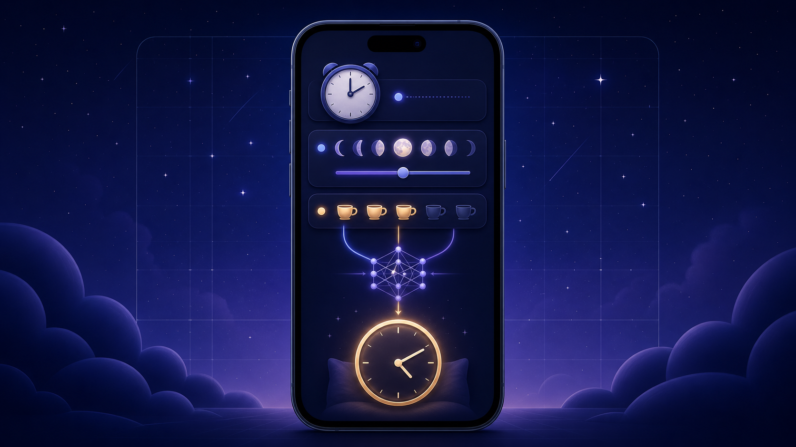

# BetterRest iOS

**A compact SwiftUI + Core ML demo that predicts an ideal bedtime from a wake-up goal, desired sleep, and daily coffee count.**

## At a glance

BetterRest is a deliberately small machine-learning app. The user chooses when they want to wake up, how many hours they would like to sleep, and how many cups of coffee they drink. A bundled tabular regression model estimates the required sleep duration, and the app subtracts that value from the chosen wake time to show an ideal bedtime.

| Model input | App control |
| --- | --- |
| <code>wake</code> | Wake time converted to seconds after midnight |
| <code>estimatedSleep</code> | Desired sleep from 4 to 12 hours in 15-minute steps |
| <code>coffee</code> | Daily coffee count from 1 to 20 cups |
| **Output: <code>actualSleep</code>** | Predicted sleep duration, used to calculate bedtime |

The model runs entirely on the device. The app does not need an API, account, backend, or network connection.

## How it works

~~~mermaid
flowchart LR
    A[Desired wake time] --> D[Core ML regressor]
    B[Desired sleep] --> D
    C[Daily coffee count] --> D
    D --> E[Predicted sleep duration]
    E --> F[Wake time minus duration]
    F --> G[Recommended bedtime]
~~~

## Features

- Native SwiftUI form with a time picker and steppers
- Bundled Create ML tabular-regression model
- On-device Core ML inference
- Clear success and failure alerts
- No account, tracking, or network dependency
- Small code surface that is easy to study

## Run the project

### Requirements

- macOS with Xcode 15 or newer
- An iOS 16+ simulator or device

This repository contains the complete app-level Swift source, asset catalog, and Core ML model, but it does **not** include an Xcode project. To run it:

1. Clone the repository.

   ~~~bash
   git clone https://github.com/Djordje3002/BetterRestIOS.git
   cd BetterRestIOS
   ~~~

2. In Xcode, create a new **iOS App** named <code>BetterRest</code> with SwiftUI and Swift.
3. Remove the generated <code>ContentView.swift</code> and app entry file from the new target.
4. Drag the contents of this repository’s <code>BetterRest/</code> directory into the project and enable **Copy items if needed** plus target membership.
5. Confirm <code>SleepCalculator.mlmodel</code> belongs to the app target.
6. Select an iPhone simulator and run.

Xcode compiles the model and generates the <code>SleepCalculator</code> Swift interface used by <code>ContentView</code>.

## Core calculation

The important inference path is intentionally direct:

~~~swift
let prediction = try model.prediction(
    wake: Double(hour + minute),
    estimatedSleep: sleepAmount,
    coffee: Double(coffeeAmount)
)

let bedtime = wakeUp - prediction.actualSleep
~~~

Keeping the calculation close to the UI makes the learning example easy to follow. A larger application would move model loading and prediction behind a dedicated service and add unit tests around the time calculation.

## Project layout

~~~text
BetterRest/
├── Assets.xcassets/
├── BetterRestApp.swift
├── ContentView.swift
└── SleepCalculator.mlmodel
~~~

## Verification

The checked-in model successfully generates its Swift interface with Apple’s <code>coremlc</code>, and the app sources type-check against the iOS Simulator SDK with Swift 6.2.

## Scope and limitations

- The app counts cups of coffee; it does not model caffeine strength, serving size, or consumption time.
- The training dataset and Create ML training script are not included, so the model cannot be independently retrained or audited from this repository.
- The recommendation is an educational prediction, not medical or sleep-health advice.
- The current implementation keeps its state and model call in one view for clarity rather than using MVVM.

## Good next steps

- Commit an Xcode project for one-click startup
- Document the model’s training data and evaluation metrics
- Add unit tests for midnight and date-boundary calculations
- Add accessibility identifiers and UI tests
- Cache the Core ML model rather than constructing it for each calculation

## Showcase artwork

The hero image was custom-generated for this repository. It mirrors only the implemented inputs and output and intentionally avoids health or accuracy claims.
